<div align="center">

# Tap Twice

**Tap once. Think twice.**
An AI money buddy that helps Gen Z pause right before they pay.

[**Try the live app**](https://tap-twice-aurania.web.app) · Built by Team AURANIA for the Google Cloud **AI Builder Cup 2026**

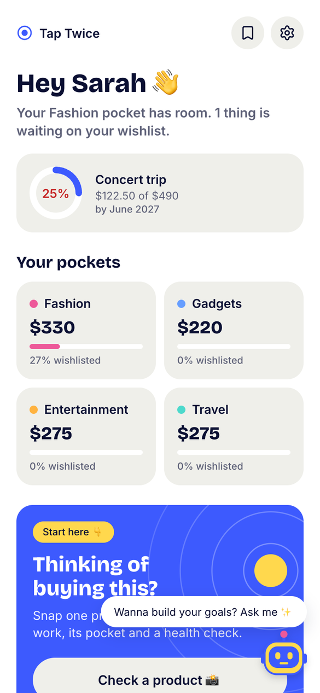
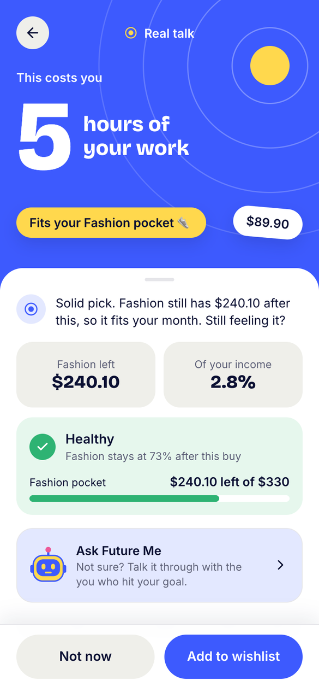
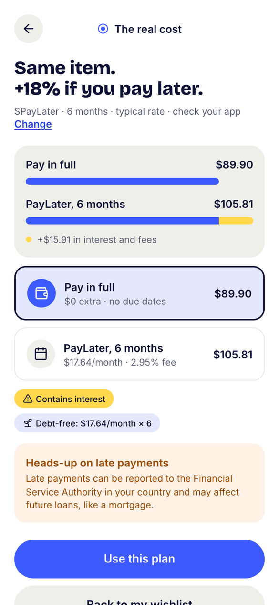
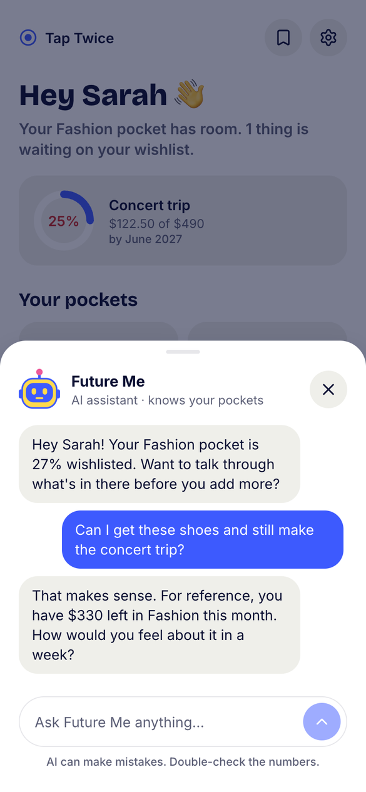

</div>

---

## The problem

Gen Z moved from "save now, enjoy later" to "enjoy now, worry later". One-tap checkout and Buy Now Pay Later (BNPL) remove the pause before paying, and small paylater balances add up to debt that follows young people for years (in Indonesia, late payments are recorded in the SLIK credit bureau and can block a first home loan).

Expense trackers work after the money is gone. Blocker apps lock you out and add guilt. Price calculators know nothing about your goals or paylater.

## The idea

Tap Twice gives you **one honest pause before you pay**. It never blocks a purchase and never shames you. Spending inside your budget is a good outcome.

1. **Snap the stuff.** Take a photo, pick a screenshot or paste a link. Gemini reads the product and its price.
2. **See your reality.** The price in hours of your work, and whether your budget pocket can take it.
3. **Decide, guilt-free.** Add it to your wishlist, see the real cost of paying later, or talk it through with **Future Me**, an AI agent that knows your pockets.

## Features

| | |
|---|---|
| **Check the stuff** | One product per scan from a photo, screenshot or link. Gemini vision + OCR returns structured data, validated before any math. |
| **Reality card** | Price in hours of work, share of income, and pocket health: Healthy, Not healthy or Pocket empty. |
| **Budget pockets** | Your monthly leftover split into Fashion, Gadgets, Entertainment, Travel and your own pockets. |
| **Wishlist** | Park items per pocket and decide later. |
| **Pay later, honestly** | Pay in full is always shown first. Pick a 3, 6 or 12 month plan and see the extra cost in money. |
| **Future Me** | A pocket-aware AI chat, one tap from any screen. It calls tools for your real numbers and never guesses. |
| **Goal tracking** | A goal ring that moves as you save. |
| **Private by design** | No sign-up, no bank login. Images are resized in the browser, processed in memory and never stored. |

English (Bahasa Indonesia is on the roadmap). Currencies: USD, IDR, INR, SGD, EUR, GBP, JPY, AUD. Foreign-currency prices are converted on the server with ECB rates.

## Screenshots

### Set up in a minute

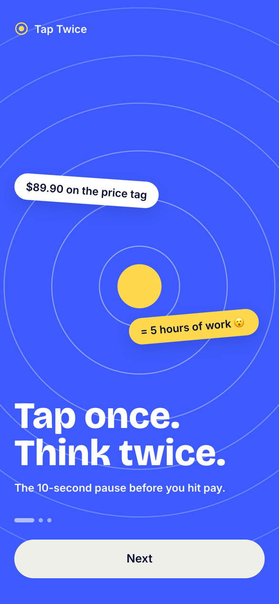 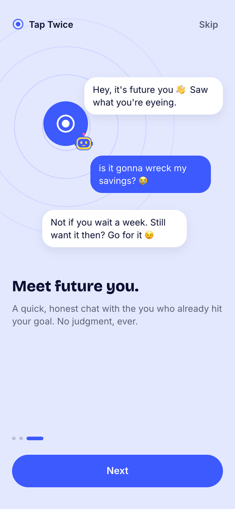 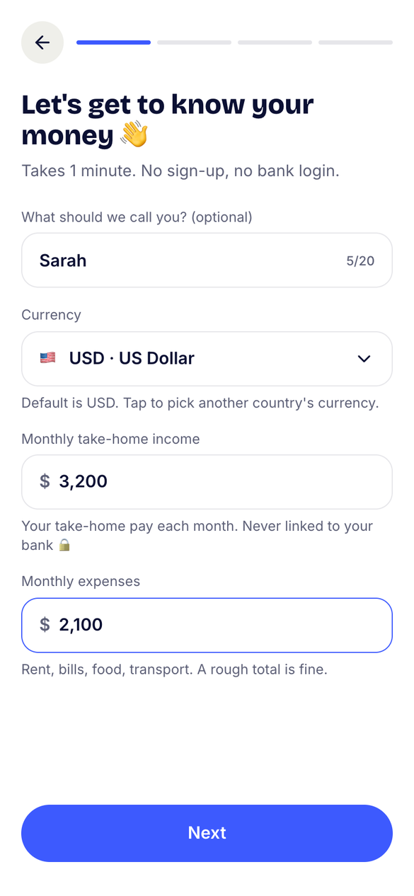 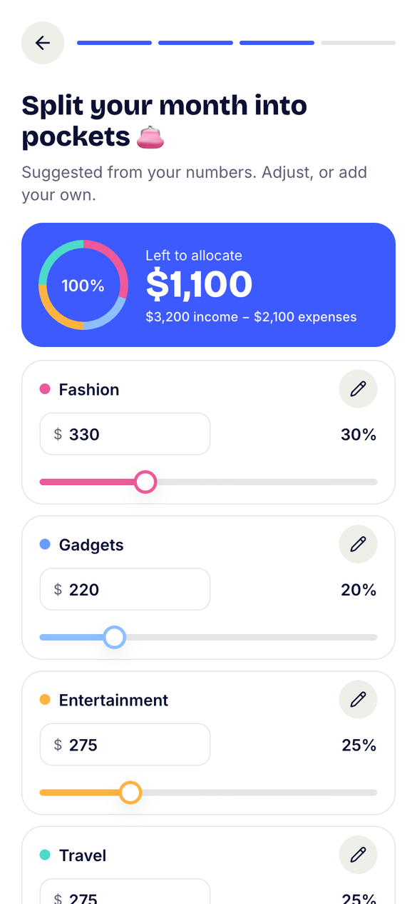 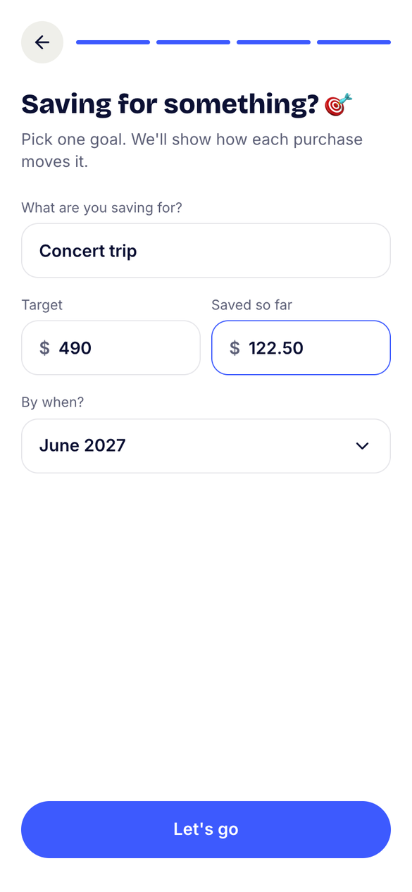

### Check the stuff

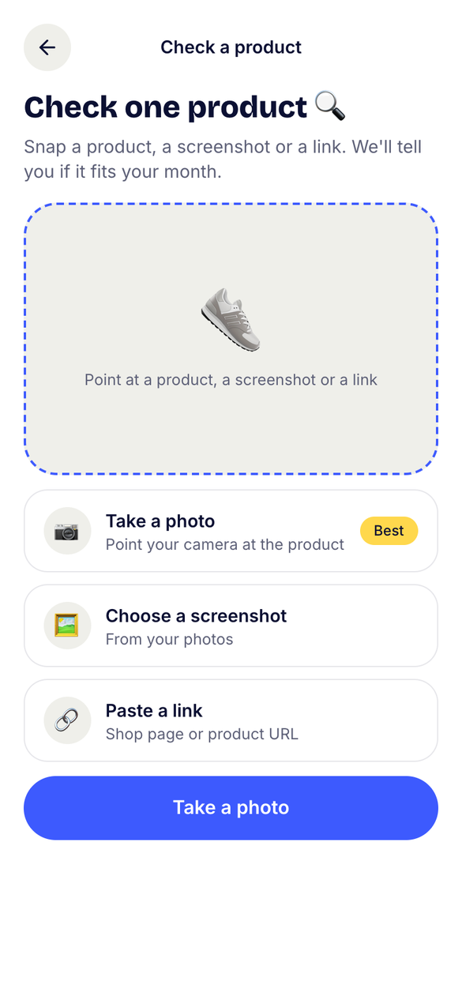 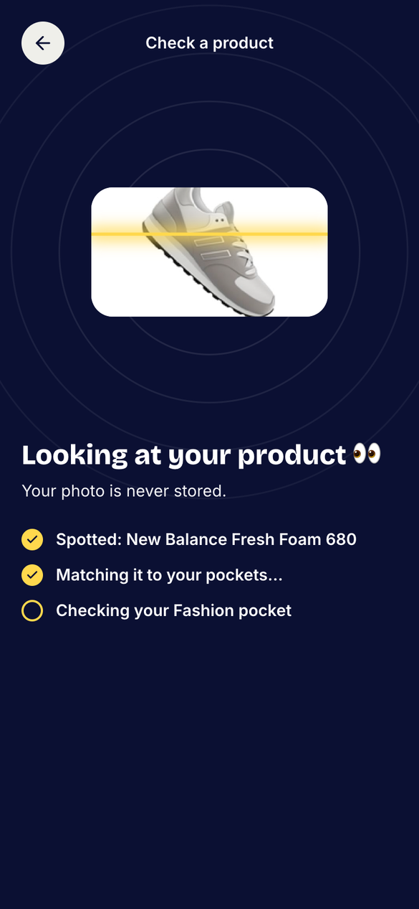 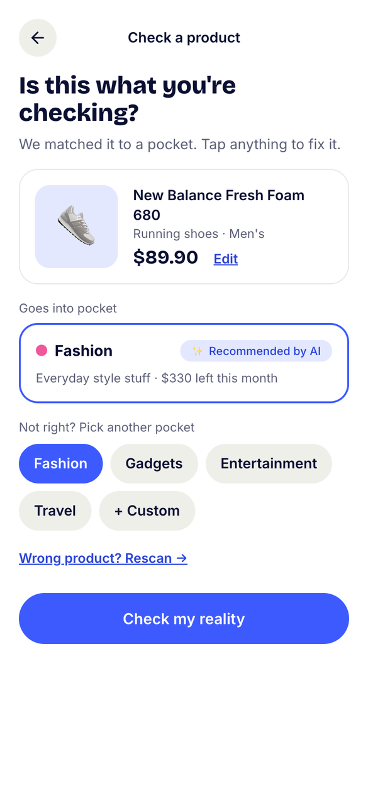  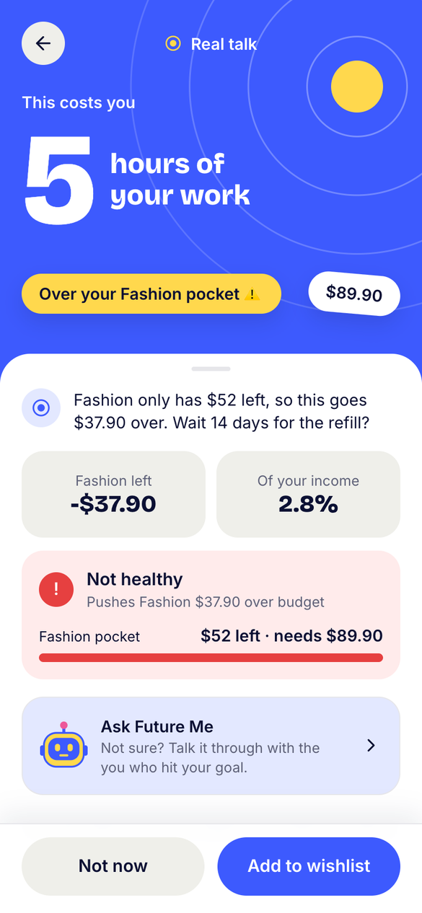

### Wishlist and paying later

 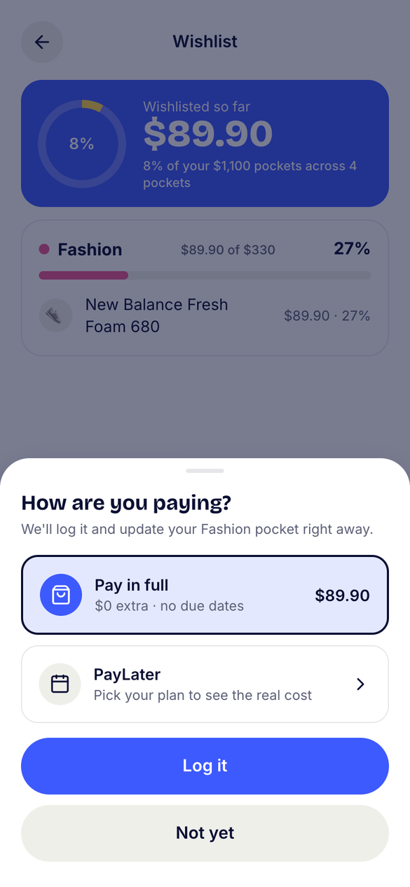 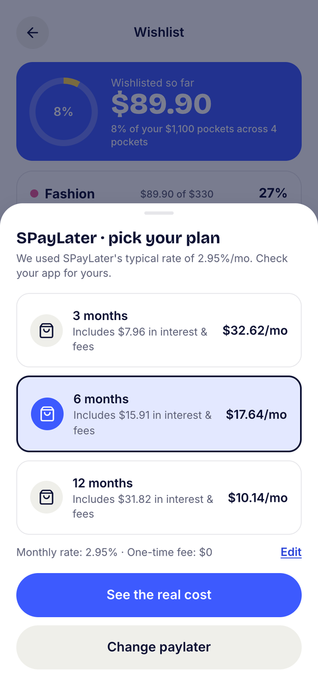  

## How it works

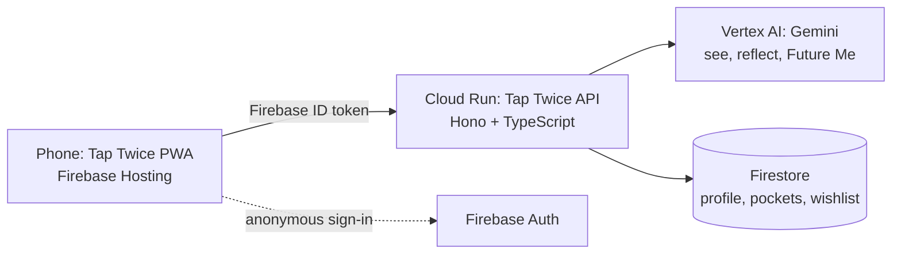

**Gemini does the reasoning. Our code does the counting.**

- **All money math is on the server**, pure and unit-tested: [`calc.ts`](api/src/calc.ts) (hourly rate, work hours, pocket budgets, health), [`summary.ts`](api/src/summary.ts), [`purchase.ts`](api/src/purchase.ts) and [`cost.ts`](api/src/cost.ts) (paylater cost). The web only displays what the API returns.
- **The AI never calculates.** It gets ready-made numbers, and its prompts forbid recomputing them, recommending lenders or products, or giving financial advice ([`ai.ts`](api/src/ai.ts)). If someone sounds stressed about debt, it answers with empathy and points to their financial authority.
- **Three AI jobs:** *See* (vision + OCR to JSON), *Reflect* (one kind, non-judgmental line) and *Future Me* (an agent using function calling, streamed live).
- **The browser never calls Gemini or Firestore.** Every request goes through the API with a Firebase ID token. There are no secrets in the app.

| Layer | Tech |
|---|---|
| Web | React 19, Vite, TypeScript, Tailwind CSS 4, installable PWA, design tokens from Figma |
| API | Node.js, Hono, Zod, Vitest, on Cloud Run (scales to zero) |
| AI | Gemini 3.5 Flash-Lite on Vertex AI, Google Gen AI SDK |
| Data and auth | Firestore (`tap-twice-db`), Firebase Auth (anonymous), Firebase Hosting |

## Project structure

```
api/        Hono API: cost engine, Gemini, Firestore, auth, rate limiting, tests
web/        React PWA (src/features = screens, src/ui = components, src/services/ai = AI interface)
scripts/    setup-gcp.sh (one-time Google Cloud setup), deploy-api.sh
firebase.json, firestore.rules   Hosting config; Firestore denies all client access
```

## Run it locally

**Prerequisites:** Node.js 24 (what the API image uses) and npm. For the real API and Gemini you also need the [`gcloud`](https://cloud.google.com/sdk/docs/install) CLI and access to the `tap-twice-aurania` project.

### 1. Web only (quickest)

The web app uses a built-in offline mock for the AI by default, and talks to the deployed API for your profile and wishlist.

```bash
cd web
cp .env.example .env.local
# fill VITE_FIREBASE_API_KEY (and VITE_FIREBASE_APP_ID):
#   firebase apps:sdkconfig WEB --project tap-twice-aurania
npm install
npm run dev        # http://localhost:5173 (the API only allows this origin)
```

Set `VITE_AI_PROVIDER=gemini` in `.env.local` to use real Gemini through the API.

### 2. With a local API

```bash
gcloud auth application-default login   # once, for Vertex AI and Firestore
cd api
cp .env.example .env
npm install
npm run dev        # http://localhost:8080
```

Then point the web at it: put `VITE_API_URL=http://localhost:8080` in `web/.env.development.local`.

`DEV_AUTH_BYPASS=1` in `api/.env` lets you call the local API with an `x-dev-uid: test` header instead of a token (never works on Cloud Run). The local API uses the project's real Firestore, so use a throwaway user. In dev builds, Home has buttons to add sample wishlist items and reset your data.

### Tests and build

```bash
npm --prefix api test
npm --prefix web test
npm --prefix web run build
```

Every shared component and the AI mock scenarios (offline, not a product, no price, camera denied) are on `/dev/components` in dev.

## Deploy

Project `tap-twice-aurania`, region `asia-southeast2`.

```bash
# Once: enable APIs, create Firestore, create the service account with Vertex AI + Firestore roles
scripts/setup-gcp.sh

# API to Cloud Run (scales to zero, $0 when idle, max 3 instances)
scripts/deploy-api.sh
scripts/deploy-api.sh 1    # demo day: keep 1 instance warm (billed while idle)
scripts/deploy-api.sh 0    # afterwards: back to zero

# Web to Firebase Hosting, and the Firestore rules
cd web && npm run build && cd ..
firebase deploy --only hosting,firestore --project tap-twice-aurania
```

The deploy script sets the service account, the Gemini model and the allowed web origins. Deploy the API and the web together when the API contract changes.

## API

Everything is under `/api` and needs `Authorization: Bearer <Firebase ID token>`, except `GET /api/health`. Request and response shapes live in [`api/src/schemas.ts`](api/src/schemas.ts).

| Method | Path | What it does |
|---|---|---|
| GET / PUT | `/profile` | Read or save income, expenses, work days, pockets and goal |
| DELETE | `/me` | Delete all of the user's data |
| POST | `/preview/budget` | Onboarding sliders: leftover and per-pocket budgets |
| GET | `/summary` | Numbers for Home and Wishlist |
| POST | `/check` | The Reality card for a product and pocket |
| POST / DELETE | `/wishlist`, `/wishlist/:id` | Wishlist items |
| POST | `/purchases` | Log a purchase: pay in full or paylater |
| POST | `/paylater/cost` | PayLater cost for a price (no side effects) |
| POST | `/ai/analyze` | Photo, screenshot or link to product, pocket and price |
| POST | `/ai/reflect` | The one-line reflection on the Reality card |
| POST | `/ai/future-me` | Future Me chat, streamed with server-sent events |

The `/ai` routes are rate limited per user; too many requests get `429 rate_limited` with `Retry-After`.

## Cost and privacy

- Cloud Run scales to zero. Pilot traffic fits the free tier; the main variable cost is Gemini calls, about a cent for a product check plus a Future Me chat.
- Photos are resized on the phone, handled in memory and never stored. Request bodies are never logged.
- Tap Twice shows costs and reflections, not financial advice.

## Roadmap

Share straight from shopping apps · Save progress with Google sign-in · Future Me by voice · More languages and credit-bureau notes.

## Team AURANIA

| | |
|---|---|
| **Aulia Nadila** (team lead) | [LinkedIn](https://www.linkedin.com/in/auliaanadila/) |
| **Ahmad Alfani Handoyo** | [LinkedIn](https://www.linkedin.com/in/ahmad-alfani-handoyo/) |
| **Muchtarruddin** | [LinkedIn](https://www.linkedin.com/in/muchtarruddin/) |

Built for the Google Cloud AI Builder Cup 2026, problem statement: BFSI, intelligent risk, fraud and financial experiences.
